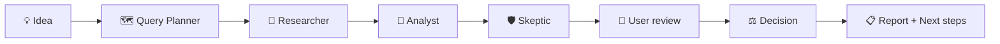

# 🧭 Business Decision Lab

**A multi-agent AI assistant that tells you whether a local business idea is worth pursuing, and why.**

It researches the market, finds similar services, separates sourced facts from assumptions, runs financial scenarios, challenges its own conclusions and gives a verdict with practical next steps.

---

## 💡 Why

Most new businesses fail on assumptions nobody checked: demand, price, competitors. Business Decision Lab acts as a small **board of AI advisors**: one researches, one analyzes, one argues against, one decides. Every claim is either backed by a real source or clearly marked as an assumption.

🇦🇲 **Armenia is the first market context.** The system works for any idea: a new business, an existing one, or a project from the diaspora.

> **Status:** working prototype, runs locally. Source code is private and available on request.

---

## ⚙️ How it works

| Agent | Role |
|---|---|
| 🗺️ **Query Planner** | Turns the idea into focused web search queries |
| 🔎 **Researcher** | Live web search limited to the target market, reads full page text |
| 📄 **Analyst** | Writes sourced facts, assumptions, financial scenarios and a list of similar services |
| 🛡️ **Skeptic** | Finds unsupported numbers, claims broader than their source, missing evidence |
| 🙋 **User review** | The user confirms, edits or rejects the numbers |
| ⚖️ **Decision** | Answers every Skeptic finding and gives the final verdict |

The interface shows **live agent activity**: each agent's tile displays what it is doing right now, then its results.

### Verdicts

| Verdict | Meaning |
|---|---|
| 🟢 **GO** | Proceed |
| 🔵 **PIVOT** | Adapt the idea |
| 🔴 **KILL** | Do not proceed in the current form |
| 🟡 **INSUFFICIENT EVIDENCE** | Not enough data for an honest call |

---

## 🧱 Design principles

- **The model interprets, the code verifies.** Every rule that matters is enforced in code, not left to the prompt.
- **No invented sources.** A fact counts as sourced only if its URL came from this analysis's search and its verbatim quote is found on that page. Otherwise it becomes an assumption.
- **Finance by tested code.** Exact decimal arithmetic; the model never supplies the results.
- **Assumptions are visible and editable.** Only the user can confirm them.
- **Honest uncertainty.** "Insufficient evidence" is a valid outcome. A GO verdict is downgraded automatically if a serious weak point has no evidence-based answer.
- **Desk research cannot prove demand.** Every report ends with real customer tests.
- **Untrusted web content.** Page text is isolated from instructions to reduce prompt-injection risk.

---

## 🛠️ Tech stack

| Layer | Tools |
|---|---|
| **Backend** | Python, FastAPI, Pydantic, LangGraph |
| **AI** | Anthropic API (Claude) with schema-validated JSON output |
| **Search** | Tavily web search with full page text |
| **Frontend** | Next.js, TypeScript, Tailwind CSS, shadcn/ui |
| **Live updates** | Server-Sent Events (SSE) |
| **Quality** | pytest: 525 automated tests, all external calls mocked by default |

**Safety by default:** secrets never in code or logs, paid API calls only when explicitly enabled, local services bound to localhost.

---

## 🗺️ Roadmap

- [ ] PostgreSQL + pgvector for persistent analyses and curated evidence
- [ ] CI with GitHub Actions and an evaluation suite (DeepEval)
- [ ] Infrastructure as code (Terraform) and a separate deployment
- [ ] Browser-based competitor inspection and opt-in user memory
- [ ] CrewAI, MCP and A2A integrations
- [ ] Trials with real users, with their consent

---

**Built by Lilia Avagyan** · AI Automation & Agentic AI

[LinkedIn](https://www.linkedin.com/in/lil-ai-travel)

